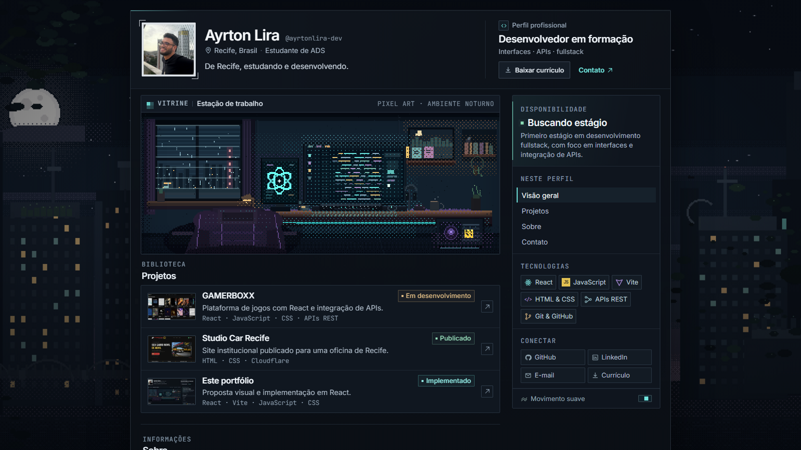
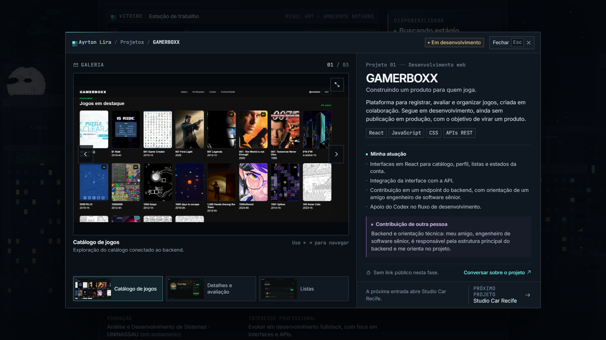
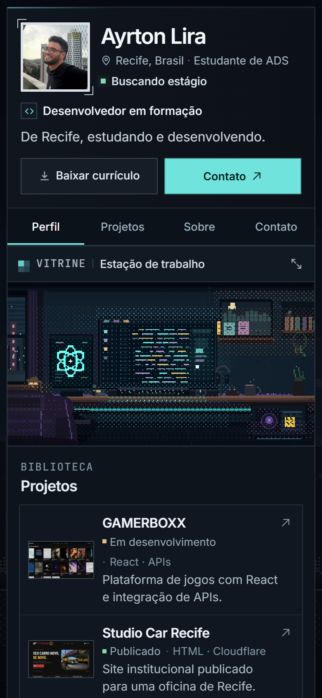

# Ayrton Lira — portfólio pessoal

Portfólio em React, Vite e JavaScript com a estrutura de um perfil de jogador:
vitrine em pixel art, biblioteca de projetos, painel de projeto acessível e
experiência mobile própria.

**Status:** aplicação implementada localmente. Publicação em domínio próprio
ainda não configurada.

## Como rodar

```bash
npm install
npm run dev
```

O Vite mostra a URL local ao iniciar, normalmente `http://127.0.0.1:5173/`.

Para gerar e conferir a versão de produção:

```bash
npm run build
npm run preview
```

O build vai para `dist/`. O `base` está definido como relativo em
`vite.config.js`, então a aplicação pode ser publicada na raiz ou em uma
subpasta de um host estático.

## O que está implementado

- Cabeçalho de perfil com foto, apresentação, papel profissional, currículo e
  contato.
- Vitrine em pixel art com controle de movimento.
- Biblioteca com os três projetos reais, status e tecnologias.
- Painel de projeto com contexto, atuação, contribuição de outras pessoas,
  galeria navegável e ampliação de imagens.
- Navegação com indicação da seção atual.
- Contexto das tecnologias por hover, foco ou toque.
- Layout responsivo em uma coluna no mobile, com navegação compacta fixa.
- Foco visível, gerenciamento de foco nos diálogos, fechamento por `Esc` e por
  clique no fundo, bloqueio de rolagem do fundo.
- Suporte a `prefers-reduced-motion` e preferência de efeitos persistida.

## Conteúdo

Todo o texto e os dados dos projetos ficam em [`src/content.js`](src/content.js).
É o lugar para atualizar:

- apresentação, links, currículo e foto;
- textos e status dos projetos;
- tecnologias e onde foram usadas;
- atividades recentes;
- o texto opcional **Como eu trabalho**.

As imagens ficam em `src/assets/images/`. O currículo atual é o PDF que estava no
perfil publicado anteriormente.

A foto atual foi aprovada e mantida. A formação na UNINASSAU e o texto de
apresentação profissional também já estão no conteúdo.

### Pendências de conteúdo

1. **Atividade recente:** `recentActivity` está vazio. O bloco só aparece com
   atualizações reais.
2. **Publicação desta versão:** o projeto está como **Implementado** e ainda não
   tem link público. Atualize `status` e `links` depois do deploy.
3. **Currículo:** substitua o PDF se houver uma versão mais nova.

O GAMERBOXX segue o briefing atual: interfaces em React, integração com a API e
contribuição em um endpoint do backend, com apoio do Codex. A estrutura principal
do backend e a orientação técnica são do amigo engenheiro de software sênior.
Nenhum número, nível, certificação ou tempo de experiência foi inventado.

## Estrutura

```text
src/
  content.js           conteúdo editável
  App.jsx              composição e estado dos diálogos
  components/          perfil, projetos, galeria, tecnologias, contato
  hooks/               seção ativa, preferência de movimento, diálogos
  styles/              fontes, base, layout, componentes e diálogos
  assets/              imagens, fontes e currículo
public/                favicon e imagem social
scripts/
  qa-browser.mjs       teste de fumaça no Chrome
design/
  entrega/             proposta visual aprovada e imagens da etapa de design
  mockups/             fontes estáticas e utilitário de captura das pranchas
  art/                 gerador e saídas da pixel art
```

## Teste de interface

Com uma versão de produção sendo servida em `http://127.0.0.1:4173/`:

```bash
npm run build
npm run preview -- --host 127.0.0.1 --port 4173 --strictPort
node scripts/qa-browser.mjs --url http://127.0.0.1:4173/
```

O teste cobre abertura e fechamento do painel de projeto, galeria por teclado,
ampliação, retorno de foco, bloqueio/restauração de rolagem, troca de projeto,
contexto de tecnologias, movimento reduzido, navegação ativa, mobile, tablet,
320 px e ausência de rolagem horizontal.







## Proposta visual

A direção aprovada e as pranchas de desktop, mobile, projeto aberto e direção de
arte estão em [`design/entrega/PROPOSTA.md`](design/entrega/PROPOSTA.md).
