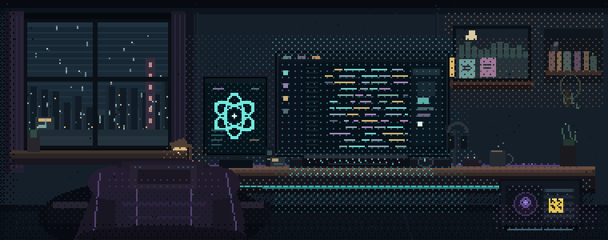

# Ayrton Lira · Portfólio

Um pouco de Steam, um pouco de Recife e os projetos que venho construindo.



## De onde veio a ideia

Jogos fazem parte da minha vida, então fazia sentido trazer isso para o meu portfólio. A referência foi o perfil da Steam: a foto, a vitrine, a biblioteca e aquela sensação de estar visitando um espaço que pertence a alguém.

Quis reinterpretar essa estrutura com a minha identidade. A biblioteca virou uma lista de projetos; cada um abre uma ficha com imagens, tecnologias, contexto e minha participação. As cores, a cidade ao fundo e as interações foram sendo ajustadas até o conjunto fazer sentido para mim.

Também queria que quem chegasse procurando um desenvolvedor encontrasse o essencial sem precisar conhecer a referência: o que estou estudando, em quais projetos trabalho e como entrar em contato.

## O que você encontra aqui

- **Projetos com contexto:** capturas, estágio de desenvolvimento e divisão de responsabilidades.
- **Galerias navegáveis:** imagens ampliáveis e navegação por teclado.
- **Links para cada projeto:** a seleção fica na URL, como `?projeto=gamerboxx`, e acompanha o histórico do navegador.
- **Uma cidade com chuva pixelada:** gotas desenhadas em canvas nas laterais do perfil, com tamanhos e velocidades diferentes.
- **Controle de movimento:** preferência salva no navegador. A chuva externa respeita movimento reduzido e pausa quando a aba fica oculta.
- **Layout responsivo:** a organização se adapta ao celular, com navegação textual e acesso direto ao currículo e contato.

## Os projetos

### GAMERBOXX

Um produto desenvolvido em colaboração, voltado a registrar, avaliar e organizar jogos.

Atuo nas interfaces em React e na integração com os endpoints existentes. O projeto conta com a colaboração de um engenheiro de software sênior, responsável pelo backend e pela orientação técnica. Ainda não está em produção.

### Studio Car Recife

Identifiquei a necessidade de um site institucional, defini o conteúdo com o cliente e conduzi a entrega, incluindo domínio, Cloudflare e publicação. O site reúne informações sobre os serviços, avaliações do Google, mapa e contato.

O layout e o código foram gerados com o Codex.

[Visitar o Studio Car Recife](https://studiocarrecife.com.br/)

### Este portfólio

Também faz parte da biblioteca. É onde reúno minhas escolhas de direção visual, conteúdo e interação, com implementação assistida por IA e revisão do resultado no navegador.

O projeto passou por várias versões. Algumas decisões vieram justamente de usar a página: reduzir o espaço da ilustração para destacar os projetos, melhorar a leitura, alinhar as colunas e tornar o controle das animações mais visível.

## Como foi desenvolvido

Usei IA durante a exploração de alternativas, implementação e revisão. Minha participação inclui definir a proposta, questionar os resultados, revisar o conteúdo e validar a experiência. A divisão de responsabilidades também aparece nas fichas dos projetos.

A aplicação usa **React, JavaScript, Vite e CSS**. A chuva externa é renderizada com **Canvas 2D**, sem atualizar o estado do React a cada quadro. Os textos e dados ficam versionados no próprio projeto; este portfólio não precisa de backend ou banco de dados para funcionar.

## Rodando localmente

Com Node.js e npm instalados:

```bash
git clone https://github.com/ayrtonlira-dev/portfolio-steam.git
cd portfolio-steam
npm ci
npm run dev
```

Abra o endereço informado pelo Vite no terminal.

Para gerar e conferir a versão de produção:

```bash
npm run build
npm run preview
```

Os arquivos de produção ficam em `dist/`. O comando de preview serve essa versão localmente; ele não publica o site.

## Onde cada coisa fica

```text
src/
  content.js     apresentação, projetos, tecnologias e links
  App.jsx        composição da página e seleção de projetos
  components/    perfil, biblioteca, galerias e chuva
  hooks/         diálogos, navegação e preferência de movimento
  styles/        estilos e adaptações de layout
  assets/        imagens, fontes e currículo
public/          favicon e imagem para compartilhamento
```

Para atualizar os projetos ou os textos do perfil, o ponto de partida é [`src/content.js`](src/content.js).

## Vamos conversar

Sou estudante de Análise e Desenvolvimento de Sistemas na UNINASSAU, em Recife, e busco meu primeiro estágio em desenvolvimento. Hoje trabalho com interfaces e integração de APIs e tenho interesse em evoluir para fullstack.

[LinkedIn](https://www.linkedin.com/in/ayrton-lira-658b873b9/) · [GitHub](https://github.com/ayrtonlira-dev) · [E-mail](mailto:ayrtonslira@gmail.com)

Feedback sobre o código, a navegação ou a apresentação dos projetos é bem-vindo.
