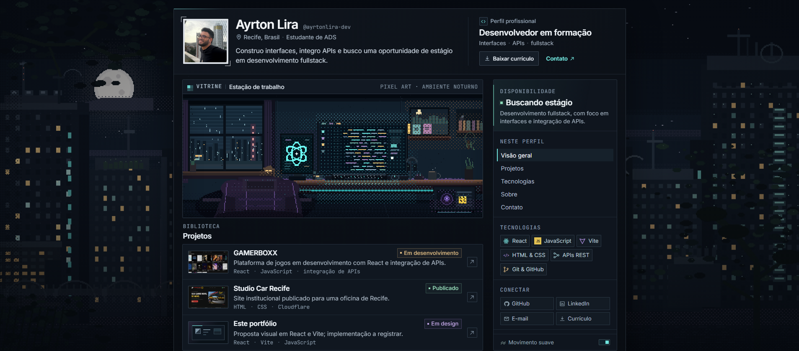
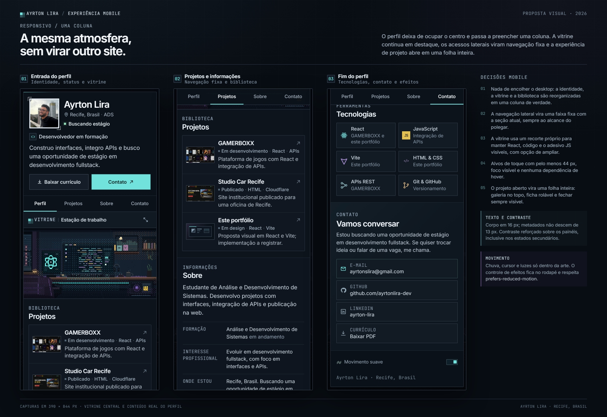
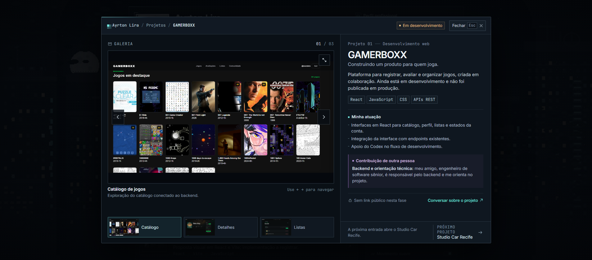
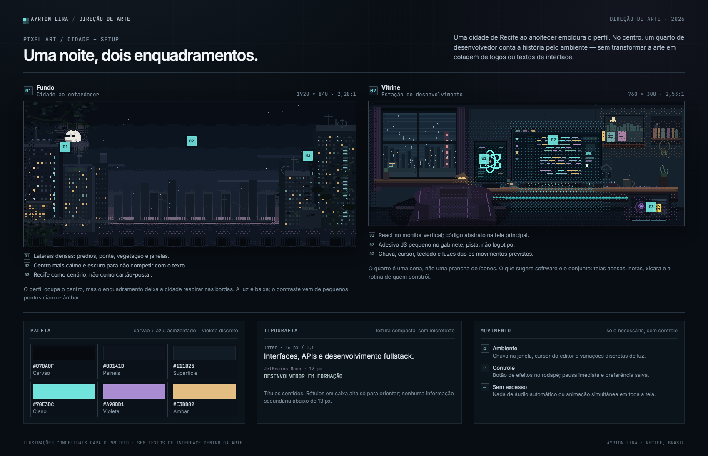

# Proposta visual — Ayrton Lira

> **Proposta aprovada e implementada.** Esta prancha registra a etapa de design.
> A aplicação atual, as decisões finais e as instruções de atualização estão no
> [README da raiz](../../README.md).

Esta foi a etapa de direção visual e desenho das telas. A implementação com React,
Vite e JavaScript foi feita depois da aprovação.

## A direção

Um perfil pessoal com a composição reconhecível de uma página de jogador — avatar
quadrado, cabeçalho compacto, vitrine, biblioteca de projetos e coluna lateral de
status e links — sem copiar a Steam. A atmosfera vem da pixel art, do contraste
entre carvão, azul acinzentado e violeta, e de pequenos pontos de ciano.

O perfil aparece como uma coluna central de 1080 px numa janela de 1907 px. A
cidade em pixel art fica visível nas laterais. O título principal continua sendo
o nome, em 30 px; não há hero de landing page, contadores inventados nem botões
gigantes.

## 1. Desktop

- Cabeçalho com foto quadrada, nome, localização, apresentação e o bloco
  **Desenvolvedor em formação**.
- **Buscando estágio** substitui qualquer status on-line fictício.
- Ações discretas: **Baixar currículo** e **Contato**.
- **Vitrine** grande no centro, com a ilustração da estação de desenvolvimento.
- **Biblioteca de projetos** em linhas contínuas — não uma sequência de cartões
  iguais. Cada linha mostra miniatura, descrição, status e tecnologias, e abre o
  projeto em um painel.
- Coluna lateral com disponibilidade, navegação da página, tecnologias,
  GitHub, LinkedIn, e-mail, currículo e controle de movimento.

Proporções principais: coluna central de 1080 px, dividida em 760 px para a
vitrine/projetos e 296 px para a barra lateral, com 24 px de respiro.

Ao rolar, a seção **Informações** usa a mesma largura das duas colunas para
formação, interesse e uma breve descrição de como você trabalha; o contato fecha
a página em uma faixa compacta. Nada de uma segunda hero ou de cartões repetidos.

## 2. Mobile

A versão mobile é uma coluna de verdade, não o desktop reduzido:

- identidade e status continuam no topo;
- a navegação lateral vira uma faixa fixa com quatro seções;
- a vitrine ganha um recorte próprio que preserva React, a interface de código e
  o adesivo JS, com opção de ampliar;
- a biblioteca mantém miniatura, status e tecnologias;
- **Sobre** reúne formação, interesse profissional e localização, no lugar de
  cartões genéricos;
- **Contato** concentra e-mail, GitHub, LinkedIn e currículo, com alvos de toque
  de pelo menos 44 px;
- o controle de movimento fica no rodapé.

As três capturas da prancha mostram a entrada do perfil, a área de projetos e o
fim da página, em 390 × 844 px.

## 3. Projeto aberto

O projeto abre como um painel sobre o perfil, com transição curta. O exemplo é o
**GAMERBOXX**:

- galeria com capturas reais, setas, miniaturas selecionáveis e botão de ampliar;
- contexto do produto e status **Em desenvolvimento**;
- **Minha atuação** separada da **Contribuição de outra pessoa**;
- backend atribuído ao amigo engenheiro de software sênior;
- nenhum link público inventado — a ausência de link é explícita;
- contato real por e-mail e navegação para o próximo projeto.

Na versão mobile, esse mesmo conteúdo se organiza como uma folha inteira, com a
galeria no topo e a ficha rolável abaixo.

Os outros dois projetos usam o mesmo painel, com conteúdo próprio:

- **Studio Car Recife:** galeria do site, contexto, publicação em domínio próprio,
  link para o site e destaque explícito de que o layout e o código foram gerados
  com o Codex.
- **Este portfólio:** recebeu o status **Implementado** depois que o painel, a
  galeria, a ampliação, a navegação ativa e o controle de movimento passaram a
  existir de verdade.

## 4. Direção de arte

**Fundo.** Cidade de Recife em pixel art ao anoitecer, com prédios, pontes, rio,
vegetação e janelas iluminadas. As laterais têm mais detalhe; o centro é mais
escuro e calmo para a leitura do perfil. A paleta usa carvão, azul acinzentado,
luzes âmbar e ciano.

**Vitrine.** Quarto gamer noturno com mesa, teclado, dois monitores, cadeira,
plantas, xícaras e pequenos objetos. O React aparece no monitor vertical, o
adesivo JS no gabinete e uma interface de código estilizada na tela principal —
sem colagem de logos e sem texto de interface embutido na arte.

**Movimento proposto.** Chuva na janela, cursor do editor e variações muito
discretas de luz. Nada se move o tempo todo. O controle de efeitos fica no canto
inferior da barra lateral; o estado inicial respeita `prefers-reduced-motion`.

## 5. Interações e acessibilidade entregues

- Projeto abre em painel; fundo inerte, foco preso no painel, `Esc` fecha e o foco
  volta ao projeto de origem.
- Galeria navegável por botões, setas do teclado e miniaturas; o botão de ampliar
  abre uma visualização maior.
- Tecnologias mostram nome e onde foram usadas por hover, foco ou toque. No mobile,
  o contexto fica visível nos próprios itens.
- Navegação ativa por seção; no mobile, a faixa fixa substitui a navegação lateral.
- Foco visível, contraste conferido, alvos de toque com pelo menos 44 px no mobile
  e nenhuma interação dependente apenas de hover.
- Sem rolagem horizontal em 320, 390, 1024 e 1121 px.
- Somente movimento ambiental na arte; nenhum áudio.

## 6. Conteúdo real e pendências

Usei como base o perfil publicado em `ayrtonlira-dev.github.io/meu-perfil/` para
foto, links e capturas reais do GAMERBOXX. Não transportei números, níveis ou
métricas da página antiga.

**Pontos de conteúdo a confirmar:**

1. **Como eu trabalho** — preenchido com a apresentação profissional enviada.
2. **Atividade recente** — o bloco só aparece quando houver atualizações reais com
   contexto no arquivo de conteúdo.
3. **Foto** — imagem pública do perfil atual, mantida conforme aprovação.
4. **Currículo** — o botão aponta para o PDF que estava no perfil atual.
5. **Links** — GitHub, LinkedIn e e-mail vieram do perfil atual. Confirme se
   continuam corretos.
6. **GAMERBOXX** — interfaces, integração com a API e contribuição em um endpoint
   do backend, com apoio do Codex. A estrutura principal do backend e a orientação
   técnica são do amigo engenheiro de software sênior.
7. **Instituição** — UNINASSAU confirmada e incluída na formação.
8. **OOP Market Simulator** — ficou fora porque você pediu três projetos.

## 7. Implementação realizada

1. App criado com React, Vite e JavaScript.
2. Conteúdo e projetos em `src/content.js`.
3. Painel de projeto, galeria, teclado e ampliação implementados.
4. Navegação ativa, contexto de tecnologias e controle de movimento implementados.
5. Testes em navegador cobrindo as interações, desktop, mobile, tablet, 320 px,
   movimento reduzido e ausência de rolagem horizontal.
6. O status de **Este portfólio** foi atualizado para **Implementado** somente
   depois de as interações existirem. A publicação externa continua pendente.

---

**Status:** aprovada em 27/10/2026. Para o estado atual, consulte o
[README da raiz](../../README.md).
